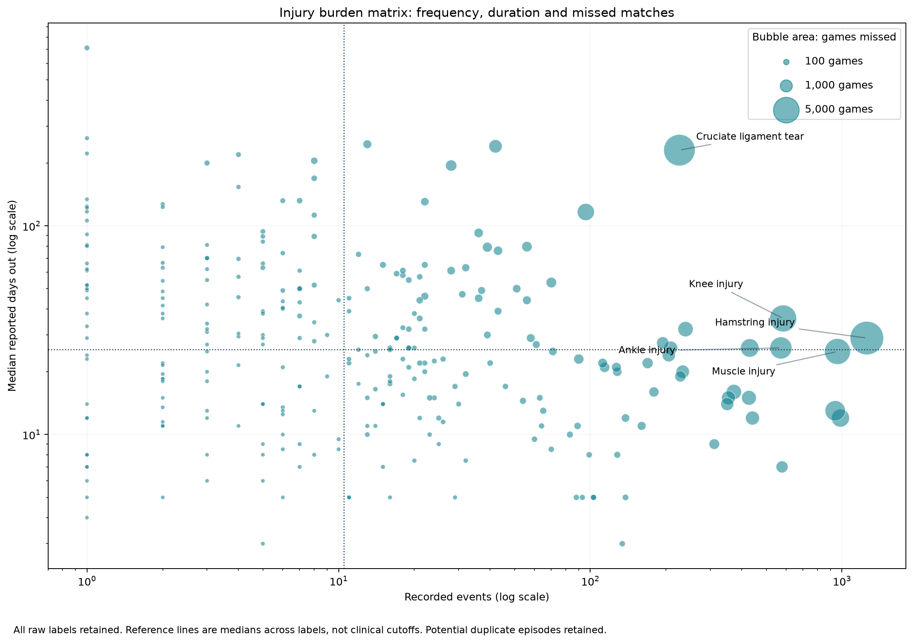

# Football Injury Burden & Player Availability Analytics

[Interactive bilingual study](https://european-football-injuries.vercel.app) · [Scientific discussion](https://european-football-injuries.vercel.app/evidence) · [Kaggle aggregate release](https://www.kaggle.com/datasets/vctorandrsgmezlpez/european-football-injuries-burden-analysis) · [Public review notebook](https://www.kaggle.com/code/vctorandrsgmezlpez/european-football-injury-burden-review) · [Portfolio](https://victor-gomez-portfolio.vercel.app/projects/european-football-injuries)

**Sports Rehabilitation & Human Performance** · Repository name: `european-football-injuries`

Analyzing 15,603 recorded absence events across Europe's top five football leagues. The count is verified from the downloaded Kaggle version 2 CSV, not assumed from its description.

This project separates recorded injury frequency, severity, recurrence and availability burden. The public release completes the supported descriptive study with an animated Spanish/English website, a critical literature discussion and aggregate-only reproducibility materials. No survival model, prediction model or external-data integration has been run: clinical endpoint meaning and exposure/eligibility denominators remain unverified.

Start with the [discussion](docs/discussion.md), [Spanish discussion](docs/discussion_es.md), [scientific audit](docs/final_scientific_audit.md), [search record](docs/literature_search.md), [public data dictionary](docs/public_data_dictionary.md) and [limitations](docs/limitations.md). The full original milestone report and named-history outputs can be regenerated locally after obtaining the original source. They are excluded from public distribution.



*Derived figure by Víctor Andrés Gómez López (2026), using Sanan Muzaffarov, Kaggle v2, CC BY-SA 4.0. Transformation: raw-label frequency, reported duration and match-loss aggregation. Episode sums can repeat days and matches.*

## Run the public website

Node 20+ is sufficient. The static site uses committed aggregate data, has no npm build dependencies, and uses no analytics, remote fonts or club logos.

```sh
git clone https://github.com/victorgomezadapty/european-football-injuries.git
cd european-football-injuries
npm test
npm run build
npm run dev
```

Open the printed local URL. League/season medians come from their own underlying records, never averages of subgroup medians. Charts include keyboard controls and matching data tables; animations support reduced-motion preferences and a pause button. GitHub is connected to Vercel for deployment updates.

The [public notebook](notebooks/public_review.ipynb) validates aggregate integrity and reconciles results. It runs offline with the attached Kaggle derivative release. It contains no original CSV or individual medical histories. The data creator remains separately credited.

## Reproduce

Use Python 3.11+ in an isolated environment. Run commands from this folder:

```powershell
python -m venv .venv
.\.venv\Scripts\python -m pip install -r requirements.txt
.\.venv\Scripts\python scripts/acquire_data.py --archive "C:\path\to\official-kaggle-version-2.zip"
.\.venv\Scripts\python -m unittest discover -s tests -v
.\.venv\Scripts\python -m src.pipeline --as-of 2026-10-26
.\.venv\Scripts\python scripts/build_notebooks.py --execute
.\.venv\Scripts\python -m scripts.export_publication
.\.venv\Scripts\python scripts/build_public_notebook.py --execute
```

See [data acquisition](docs/data_acquisition.md) for the official download and version selection. A new clone contains the checksum manifest, not the original raw file. `--archive` restores the exact registered bytes and verifies them; it refuses a different source version. Never edit files under `data/raw/`. The acquisition script does not contain or save credentials. The analysis has no network calls. Detailed notebooks generated from the source remain local because they display named histories.

`requirements.txt` specifies compatible ranges. `reports/run_manifest.json` records the actual analysis runtime, source checksum and parameters. `requirements-lock.txt` records versions used for this delivery. The default analysis date is explicit and reproducible; change `--as-of` deliberately for a new review.

## Read the metrics correctly

- Injury occurrence is a record count. Injury incidence needs exposure hours.
- Frequency, per-event severity and cumulative burden measure different things.
- Summed episode-days and matches may double count overlapping or repeated episodes.
- Repeated labels do not establish clinical reinjury.
- Games missed do not establish an availability percentage.
- Historical associations do not establish future injury predictions.

All 15,603 reported durations match inclusive date counting. There are no exact whole-row duplicates, but 1,973 rows belong to possible repeated-episode groups. The report includes candidate-collapsing sensitivity rather than silently merging different club contexts. The player ID is an exact-name surrogate and requires verification before external joins.

## Layout

```text
data/raw/         Original Kaggle archive and CSV, checksum manifest
data/interim/     Standardized records with source values and quality flags
data/processed/   Event sequences, burden profiles, candidate-episode sensitivity
notebooks/        01–06, 08–09 descriptive analyses; 07 and 10 explicitly deferred
src/data/         Load, parse and validate
src/features/     Burden, label repetition, histories and draft taxonomy
src/analysis/     Frequency, duration and calendar summaries
src/validation/   Date-order and future-leakage guards
src/visualization/ Static PNG/SVG figures and player timelines
docs/             Definitions, methodology, source, taxonomy and limitations
reports/          Milestone report, runtime/summary JSON, tables and figures
handoff/          Feature catalog, metrics, findings and integration proposal
tests/            Parsing, overlap, duplicate and timing boundary checks
scripts/          Acquisition and reproducible notebook generation
references/       Verified DOI metadata and BibTeX
web/              Static bilingual site, aggregate views and licensed downloads
.github/          Python tests and public-data website checks
```

## Portfolio context

Running Injury Clinic asks **How does the athlete move?** Competitive Runners asks **What happened before injury?** This project asks **What happened after a recorded injury or absence?**

Together they address movement, training exposure, injury, time loss, recorded return and availability. They have different observation units and their rows must not be merged.

## Source and attribution

Sanan Muzaffarov, [European Football Injuries (2020–2025), Kaggle version 2](https://www.kaggle.com/datasets/sananmuzaffarov/european-football-injuries-2020-2025/versions/2), downloaded 26 October 2026. Kaggle displays [CC BY-SA 4.0](https://creativecommons.org/licenses/by-sa/4.0/) for the dataset. Derived transformations and analytical changes are documented. The associated DOI supplied in the brief is `10.34740/KAGGLE/DSV/14465228`; correspondence to version 2 remains unverified. No independent upstream clinical-source verification has been completed.

**Public release 1.0:** descriptive analysis, scientific audit, cited discussion and open reproduction. Future incidence, availability or time-to-return modeling first requires adjudicated episodes, verified identity, clinical endpoint meaning and eligible exposure windows. More modeling does not repair a missing denominator.

Original code: [MIT](LICENSE). Derived tables and figures: [CC BY-SA 4.0 attribution and transformation notice](DATA_LICENSE.md). Scientific articles retain their own rights; findings are paraphrased and linked without republishing full articles or third-party figures. See [CITATION.cff](CITATION.cff) and the [bibliography](references/references.bib). The public release does not redistribute the original CSV or individual medical histories.

The published Kaggle notebook wrapper displays Apache License 2.0. It does not replace MIT for the original project source or CC BY-SA 4.0 for derived tables/figures. The [notebook-license notice](NOTEBOOK_LICENSE.md) documents that platform distinction.
